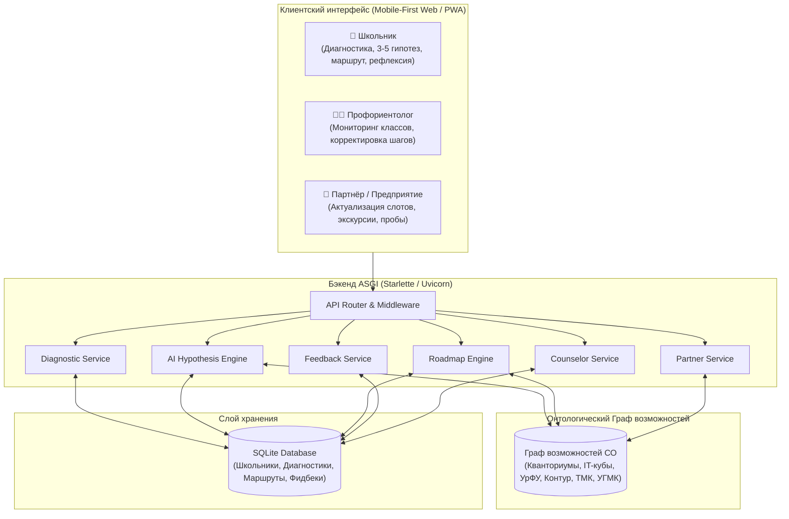

# Профессиональный навигатор (Свердловская область)

[](#)
[-green.svg)](#)
[](#)
[](#)
[](#)

> **Название для диплома**: Проект по теме **«Профессиональный навигатор»**  
> **Цель**: Создать ИИ-сервис, который превращает результаты профориентационной диагностики школьника в персональный, проверяемый на практике маршрут к профессии, связывая интересы школьника с реальными образовательными возможностями и предприятиями Свердловской области.

---

## 📌 Проблема: Разрыв между диагностикой и действием

В Свердловской области создана одна из самых развитых в России профориентационных инфраструктур:
- Детские технопарки **«Кванториум»** (Екатеринбург, Верхняя Пышма, Первоуральск, Новоуральск);
- Центры цифрового образования детей **«IT-куб»** (Екатеринбург: Уралмаш, Солнечный);
- Кластеры федерального проекта **«Профессионалитет»** и колледжи (УРТК им. Попова, Первоуральский металлургический колледж);
- Ведущие вузы (**УрФУ**, **УГГУ**, **УГМУ**);
- Индустриальные лидеры (**СКБ Контур**, **ПАО ТМК**, **Группа Синара**, **УГМК**, **ВСМПО-АВИСМА**).

Однако между результатом психологического тестирования («склонность к типу Человек-Техника») и реальным выбором школьника возникает **разрыв**: школьник и родители не знают, куда конкретно пойти в своем городе, где пройти практическую пробу и какие предприятия ждут таких специалистов.

**«Профессиональный навигатор»** решает эту проблему через деятельностный подход:  
`Диагностика` $\rightarrow$ `3–5 гипотез` $\rightarrow$ `Персональный маршрут` $\rightarrow$ `Профпроба в СО` $\rightarrow$ `Обратная связь и подтверждение гипотезы` $\rightarrow$ `Кураторство профориентолога`.

---

## 🎯 Соответствие 7 критериям оценки диплома

| № | Критерий оценки | Как реализовано в сервисе | Модуль в репозитории |
|---|---|---|---|
| **1** | **3–5 профессиональных гипотез** на основе диагностики | Принимает профиль интересов, тип по Климову, коды Голланда и локацию. Взвешенный скоринг ранжирует профессии и отбирает от 3 до 5 гипотез с прозрачным объяснением ИИ. | [`app/services/hypothesis_service.py`](file:///home/user/proj/prof_navigator/app/services/hypothesis_service.py) |
| **2** | **Персональный маршрут** для каждой гипотезы | Генерирует 4-шаговый маршрут: 1) Онлайн-знакомство $\rightarrow$ 2) Очная профпроба на площадке СО $\rightarrow$ 3) Проект в технопарке $\rightarrow$ 4) СПО/ВУЗ + предприятие региона. | [`app/services/roadmap_service.py`](file:///home/user/proj/prof_navigator/app/services/roadmap_service.py) |
| **3** | **Обратная связь после профессиональной пробы** | Чек-ин рефлексии (оценка интереса 1-5, сложность, впечатления, готовность продолжать). Автоматический пересчет статуса гипотезы (`confirmed`, `doubted`, `rejected`). | [`app/services/feedback_service.py`](file:///home/user/proj/prof_navigator/app/services/feedback_service.py) |
| **4** | **Кабинет профориентолога** с корректировкой маршрутов | Наставник видит прикрепленный класс/школу, гипотезы учеников, прогресс по шагам, может добавлять индивидуальные шаги и задания, а также комментировать шаги. | [`app/services/counselor_service.py`](file:///home/user/proj/prof_navigator/app/services/counselor_service.py) |
| **5** | **Граф возможностей** с согласованным набором данных | Формализованная база знаний по Свердловской области (`sverdlovsk_graph.json`): отрасли, профессии, Кванториумы, ВУЗы, заводы. 100% валидированная связность без битых внешних ссылок. | [`app/services/graph_service.py`](file:///home/user/proj/prof_navigator/app/services/graph_service.py) |
| **6** | **Партнёры предоставляют актуальные данные** | Кабинет предприятия / колледжа: подтверждение актуальности дат (с фиксацией временной метки), открытие новых слотов на экскурсии и профпробы. | [`app/services/partner_service.py`](file:///home/user/proj/prof_navigator/app/services/partner_service.py) |
| **7** | **Работа в браузере на мобильных устройствах** | Mobile-First адаптивный интерфейс (PWA-ready), сенсорные карточки, крупная типографика, мгновенный отклик без тяжелых бандлов в любом мобильном браузере. | [`app/templates/index.html`](file:///home/user/proj/prof_navigator/app/templates/index.html), [`app/static/css/styles.css`](file:///home/user/proj/prof_navigator/app/static/css/styles.css) |

---

## 🏛 Архитектура системы



---

## 💻 Технологический стек

- **Бэкенд**: Python 3.12+ / 3.14 (асинхронное ядро на базе Starlette ASGI, поддержка асинхронных запросов, быстрая сериализация).
- **База данных**: Встроенная SQLite с типизированными реляционными таблицами (`students`, `hypotheses`, `roadmaps`, `roadmap_steps`, `trial_feedbacks`, `partner_trial_overrides`).
- **Граф возможностей**: Иерархическая онтологическая модель связей Свердловской области в JSON с валидацией связности в памяти.
- **Интеллектуальный слой (AI)**:
  - Взвешенный онтологический скоринг по 5 факторам (интересы, тип Климова, коды Голланда RIASEC, региональный приоритет промышленности СО, географическая доступность);
  - Генератор персонализированных текстовых обоснований гипотез;
  - Адаптивный пересчет статуса гипотезы по результатам рефлексии школьника.
- **Фронтенд**: Mobile-First Responsive Web Application (чистый ES6+, компонентный CSS, адаптивная сетка, touch-friendly элементы, нулевые внешние зависимости сборки).

---

## 📂 Структура репозитория

```
prof_navigator/
├── app/
│   ├── api/
│   │   ├── __init__.py
│   │   └── routes.py             # Маршруты REST API и веб-страниц
│   ├── services/
│   │   ├── __init__.py
│   │   ├── graph_service.py      # Граф возможностей СО и проверка связности (Критерий 5)
│   │   ├── diagnostic_service.py # Прием анкеты и тестов
│   │   ├── hypothesis_service.py # Генерация 3-5 гипотез со скорингом (Критерий 1)
│   │   ├── roadmap_service.py    # Построение 4-шаговых маршрутов (Критерий 2)
│   │   ├── feedback_service.py   # Рефлексия после пробы и пересчет гипотез (Критерий 3)
│   │   ├── counselor_service.py  # Кабинет профориентолога (Критерий 4)
│   │   └── partner_service.py    # Кабинет партнера и слоты (Критерий 6)
│   ├── static/
│   │   ├── css/
│   │   │   └── styles.css        # Мобильно-адаптивные стили (Критерий 7)
│   │   └── js/
│   │       └── app.js            # Логика SPA и интерактивные сценарии
│   ├── templates/
│   │   └── index.html            # Главный интерфейс с переключателем ролей
│   ├── config.py                 # Пути и параметры запуска
│   ├── database.py               # Инициализация таблиц БД SQLite
│   ├── main.py                   # Сборка ASGI приложения Starlette
│   └── models.py                 # Датаклассы сущностей
├── data/
│   └── sverdlovsk_graph.json     # Согласованный датасет инфраструктуры Свердловской области
├── docs/
│   ├── ARCHITECTURE.md           # Детальная архитектурная спецификация
│   ├── CRITERIA_COMPLIANCE.md    # Доказательная база по 7 критериям
│   └── ONTOLOGY.md               # Онтология сущностей региона
├── tests/
│   ├── __init__.py
│   └── test_scenario.py          # Автоматические тесты 7 критериев
├── run.py                        # Точка входа для запуска веб-сервера
├── .gitignore                    # Исключения Git
└── README.md                     # Описание проекта
```

---

## 🚀 Быстрый запуск

### 1. Запуск прототипа:
```bash
python3 run.py
```
После запуска откройте в браузере (на компьютере или в мобильном браузере через локальную сеть):
👉 **http://localhost:8000**

### 2. Запуск сквозных тестов всех 7 критериев:
```bash
python3 -m unittest tests/test_scenario.py
```
Результат прохождения тестов:
```
Ran 7 tests in 0.209s
OK
```

---

## 🎬 Сценарий демонстрации работы (Walkthrough)

1. **Роль «Школьник»**:
   - Нажмите кнопку **«⚡ Заполнить демо (9 класс)»** (ученик из Екатеринбурга с интересом к программированию, математике и робототехнике);
   - Нажмите **«🚀 Построить профессиональные гипотезы»**;
   - Система сформирует **4 профессиональные гипотезы** (Критерий 1) с процентом совпадения и обоснованием с учетом предприятий региона;
   - Нажмите **«🚀 Открыть персональный маршрут»** — откроется 4-шаговый маршрут: от экспресс-разбора до реальной пробы в *«IT-куб. Уралмаш»* и программ *ИРИТ-РТФ УрФУ / СКБ Контур* (Критерий 2);
   - Нажмите **«🎯 Пройти пробу и оставить отзыв»** $\rightarrow$ заполните рефлексию на 5 звезд $\rightarrow$ статус гипотезы изменится на **«✅ Подтверждена практикой»** (Критерий 3).

2. **Роль «Наставник»**:
   - Переключитесь на вкладку **«🧑‍🏫 Наставник»**;
   - В таблице появится зарегистрированный школьник со своим прогрессом;
   - Нажмите **«👁 Маршруты»** $\rightarrow$ просмотрите шаги;
   - Нажмите **«➕ Добавить персональный шаг»** $\rightarrow$ введите персональное задание $\rightarrow$ шаг мгновенно появится в маршруте ученика (Критерий 4).

3. **Роль «Партнёр»**:
   - Переключитесь на вкладку **«🏢 Партнёр»**;
   - Найдите мероприятие от *СКБ Контур* или *ПМК*;
   - Нажмите **«✓ Подтвердить»** — обновится статус и дата верификации (Критерий 6);
   - Нажмите **«➕ Добавить слот»** — добавьте новую дату проведения экскурсии или пробы.

